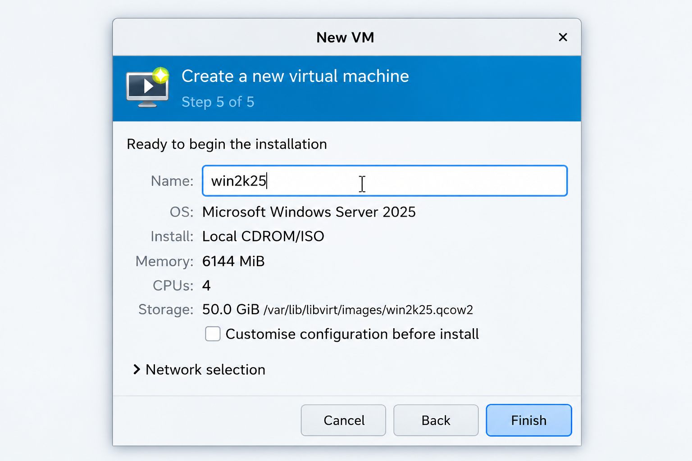
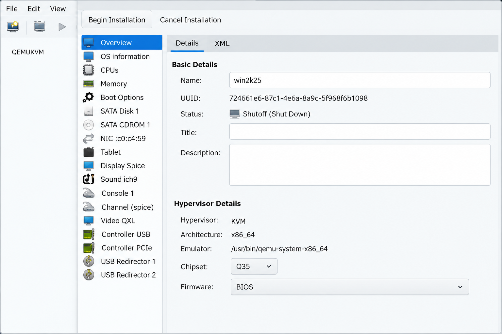
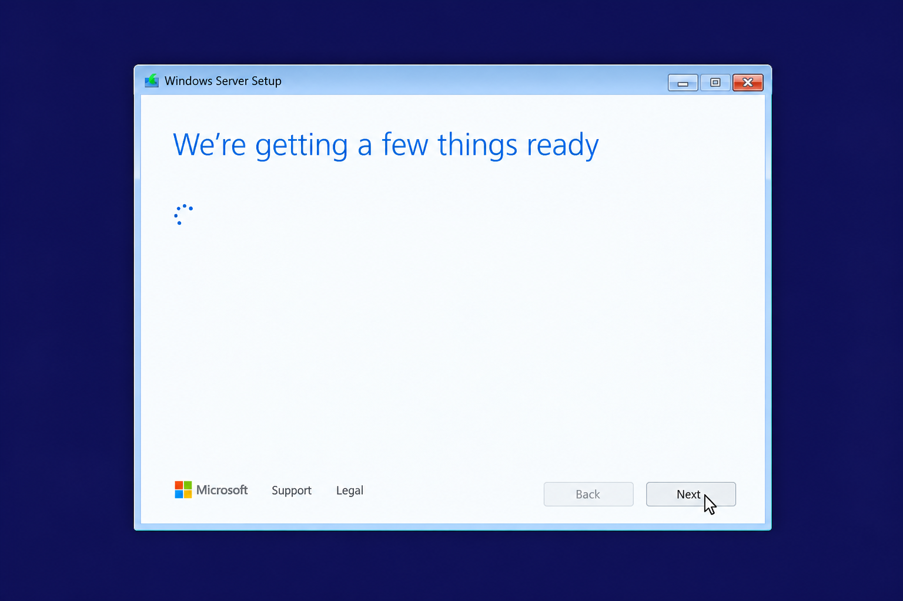
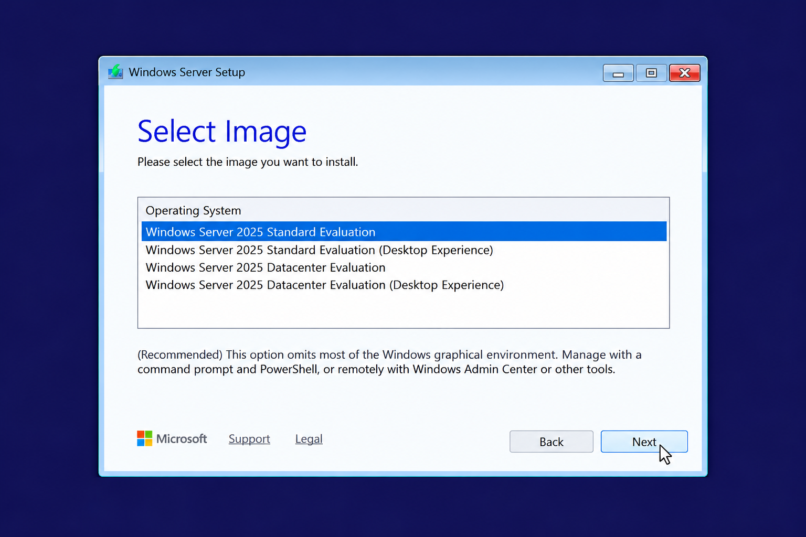
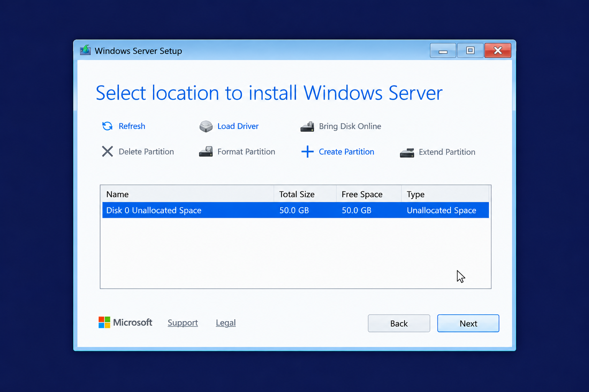
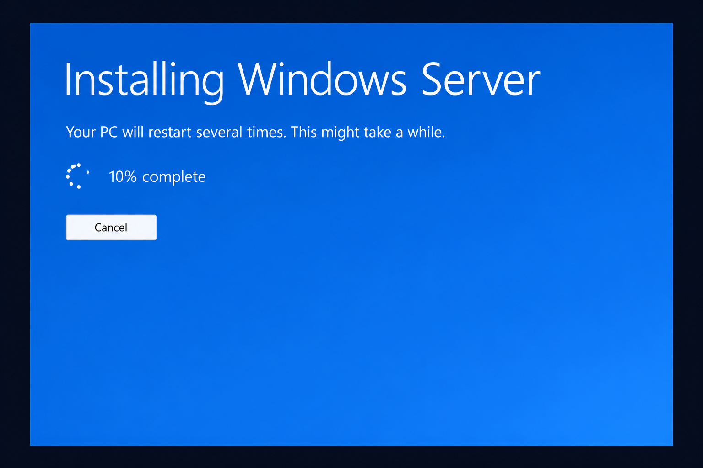
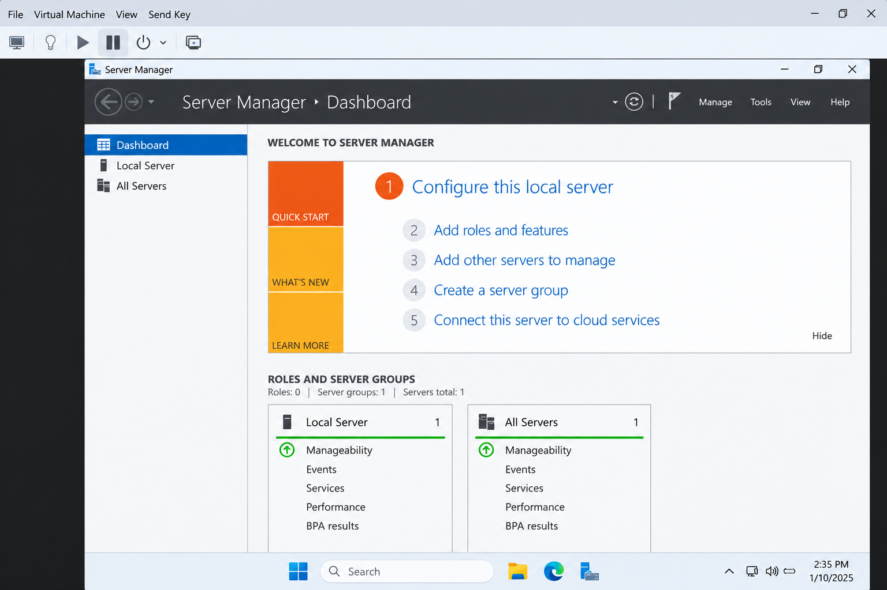

# Lab 01 — Install Windows Server 2025 in KVM

**Status:** Completed  
**Focus:** Windows Server installation and first boot

## Objective

Install Windows Server 2025 in a virtual machine and confirm that the graphical desktop and Server Manager load successfully.

## Lab environment

| Component | Configuration |
| --- | --- |
| Host OS | Fedora Linux |
| Hypervisor | QEMU/KVM, managed with virt-manager |
| Host CPU | Intel Core i5-1235U |
| Host memory | Approximately 16 GB |
| VM name | `win2k25` |
| Guest OS | Windows Server 2025 Standard Evaluation (Desktop Experience) |
| VM memory | 6144 MiB |
| Virtual CPUs | 4 |
| Virtual disk | 50 GiB, qcow2 |
| Installation media | Windows Server 2025 Evaluation ISO |

## What I did

1. Checked that the host supports Intel VT-x virtualization and reviewed available storage.
2. Created a virtual machine in virt-manager named `win2k25`, assigning 6144 MiB of memory, 4 virtual CPUs, and a 50 GiB virtual disk.
3. Reviewed the VM hardware in virt-manager, including the KVM hypervisor, x86_64 architecture, Q35 chipset, BIOS firmware, virtual disk, CD-ROM, and network interface.
4. Booted the VM from the Windows Server 2025 evaluation ISO.
5. Chose **Windows Server 2025 Standard Evaluation (Desktop Experience)** for the installation. The edition-selection photo was taken while the first (non-Desktop Experience) entry was highlighted; the final installed edition was Desktop Experience.
6. Selected **Disk 0 Unallocated Space (50 GB)** as the installation target.
7. Waited for setup to finish and the VM to restart.
8. Set the Administrator password during setup (not recorded in this repository), signed in, and opened Server Manager.

## Installation photos

These seven screenshots document the VM setup, Windows installation, and Server Manager after the first sign-in.

### 1. Created the virtual machine in virt-manager.

### 2. Reviewed the virtual machine installation details.

### 3. Started Windows Server Setup from the installation ISO.

### 4. Selected the Windows Server image for installation.

### 5. Selected the virtual disk partition.

### 6. Waited for Windows Server installation to finish.

### 7. Opened Server Manager after the first sign-in.

## Verification

- [x] Windows Server installation completed.
- [x] Administrator session loaded.
- [x] Windows desktop and Server Manager dashboard appeared.
- [ ] OS build verification using `winver` — planned for Lab 02.
- [ ] Server name and network configuration — planned for Lab 02.

## What I learned

The VM's virtual CPUs, RAM, and disk are allocated from the Fedora host. The installation ISO acts as bootable media, while the qcow2 virtual disk stores the installed operating system. Choosing **Desktop Experience** provides a graphical interface, which is useful for learning Server Manager before moving to command-line administration.

## Interview practice

**What is a hypervisor?**  
Software that runs virtual machines and manages their access to host resources. This lab used KVM with QEMU and virt-manager.

**What is the difference between Server Core and Desktop Experience?**  
Server Core has a minimal local interface and is mainly managed through command-line and remote tools. Desktop Experience includes the Windows graphical desktop.

**What is a qcow2 file?**  
A QEMU virtual disk image format used to store a VM's disk contents.

**Why check virtualization support?**  
Hardware virtualization support helps KVM run guest operating systems efficiently.

**How did you verify the installation?**  
I signed in as Administrator and confirmed that the Windows desktop and Server Manager dashboard opened.

## Next lab

Lab 02: Check the Windows Server version, review Local Server properties, rename the machine, and configure networking.
