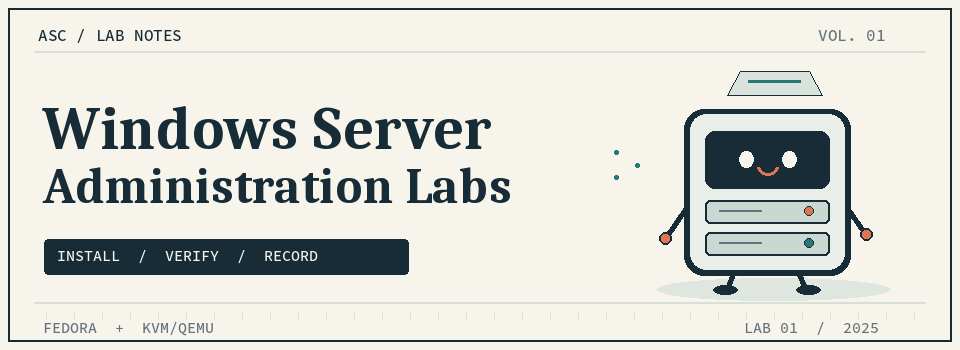

  

# Windows Server Administration Labs

My lab portfolio for learning Windows Server administration. Each entry records the setup, the steps taken, and what I verified, with original photos from the lab.

---

## Lab index

| No. | Lab | Environment | Status |
| :-- | :-- | :-- | :-- |
| 01 | [Install Windows Server 2025 in KVM](Lab-01-Windows-Server-2025-Installation/README.md) | Fedora Linux · KVM/QEMU · virt-manager | Complete |

## Lab 01 · Installation and first boot

I installed **Windows Server 2025 Standard Evaluation (Desktop Experience)** in a VM named `win2k25`, using 6144 MiB of RAM, 4 vCPUs, and a 50 GiB virtual disk. The lab documents setup through Administrator sign-in and the Server Manager dashboard.

**[Read Lab 01 and view the seven installation screenshots →](Lab-01-Windows-Server-2025-Installation/README.md)**

---

Future labs will be listed here as they are completed.
